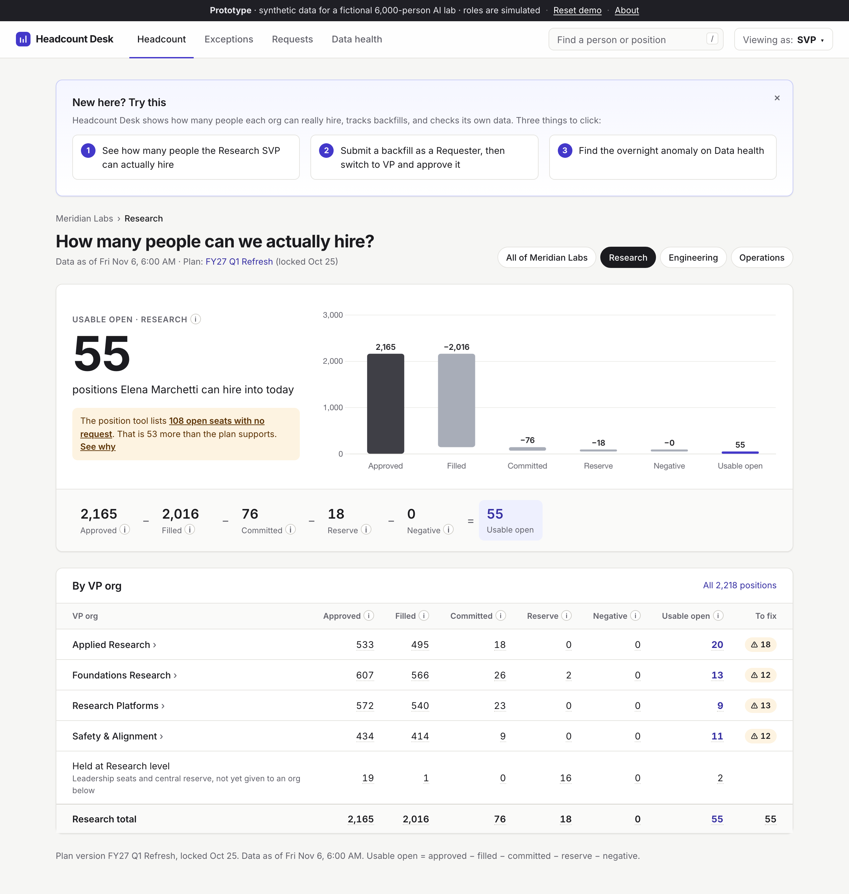
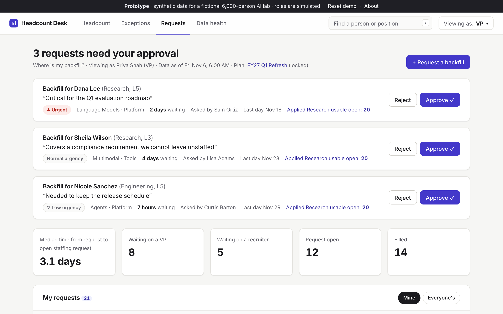
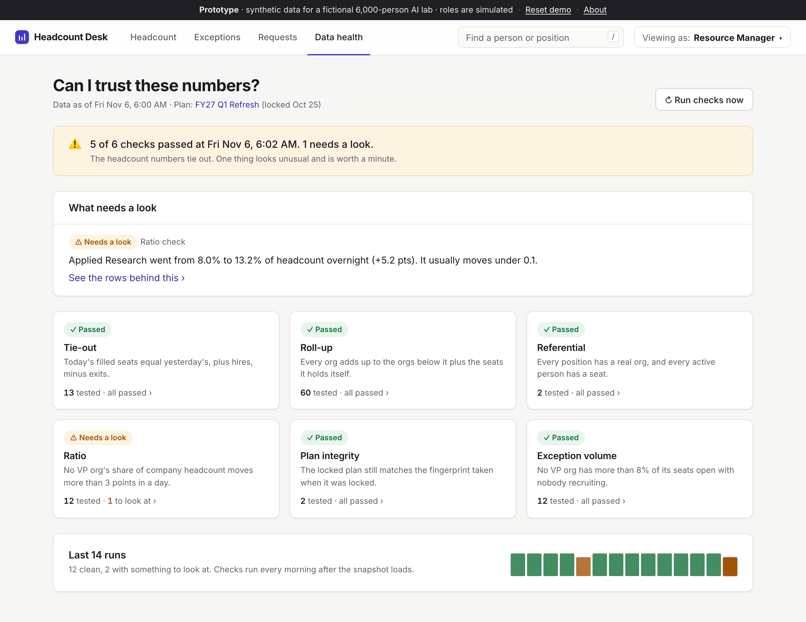
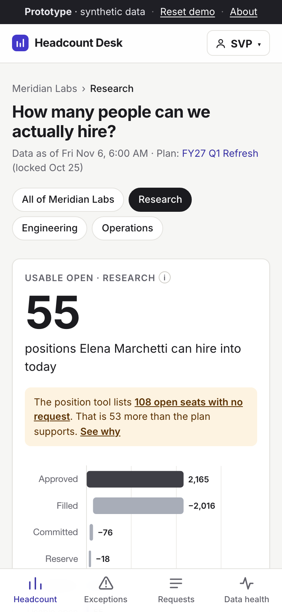

# Headcount Desk

**How many people can we actually hire?** Headcount Desk is a working prototype that answers that question for a fictional 6,000-person AI research lab. It turns a noisy list of positions into usable open headcount for each SVP, replaces a manual backfill process with one tracked flow, and checks its own data every day.

**Live demo:** https://headcount-desk-yf5labkepq-ue.a.run.app

All data is synthetic. The company ("Meridian Labs"), the people and the numbers are made up, and errors are planted on purpose so there is something to find.



## What it does

| Page | The question it answers | What you see |
|---|---|---|
| **Headcount** | How many people can we actually hire? | Usable open for an SVP, the math behind it, and the same numbers for each org below. Every number opens the rows behind it. |
| **Exceptions** | What's wrong in the data, and who fixes it? | Stale opens, duplicates, ghost fills, mis-coded seats and misplaced reserve, as a to-do list grouped by owner. |
| **Requests** | Where is my backfill? | A two-question request form, a one-click approval inbox for the VP, an auto-assigned recruiter, and a full audit trail. |
| **Data health** | Can I trust these numbers? | Six daily checks, reported in plain sentences, with links to the rows. |

Try it in two minutes:

1. Open **Headcount** and click any number to see the positions behind it.
2. Open **Requests → Request a backfill** as a Requester, submit one, then switch to **VP** (top right) and approve it.
3. Open **Data health** and find the overnight anomaly.

| Approval inbox | Data health | On a phone |
|---|---|---|
|  |  |  |

## How it works

```
usable open = approved (latest locked plan)
            − filled
            − committed (open staffing requests + offers out)
            − reserve held centrally
            − negative headcount (over-hires)
```

- **The logic is SQL.** Usable open, the exception rules and the data checks are Postgres views in [`db/`](db). Python only routes requests and renders pages, so anyone who reads SQL can check a rule.
- **A position's status is derived, never stored.** `v_position_status` works out whether a seat is filled, committed or open from the facts, so it cannot drift.
- **The plan is versioned and locked.** A trigger blocks edits to a locked plan, and a stored fingerprint lets a daily check prove nobody got around the trigger.
- **One function owns the workflow.** `app/workflow.py: transition()` is the only code that changes a backfill's status, and it writes the audit row in the same transaction.

More in [docs/PRD.md](docs/PRD.md) (problem, users, roadmap), [docs/SCHEMA.md](docs/SCHEMA.md) (tables, views, ER diagram) and [docs/DECISIONS.md](docs/DECISIONS.md) (each choice and the alternative). [docs/WALKTHROUGH.md](docs/WALKTHROUGH.md) is a ten-minute guided read of the code.

## Stack

| Layer | Choice |
|---|---|
| Language | Python 3.12, managed with `uv` |
| Web | FastAPI, Jinja2 templates, HTMX for in-place updates |
| Styling | One hand-written stylesheet (`app/static/app.css`), no framework |
| Chart | Chart.js, one waterfall |
| Database | Postgres (Neon), `psycopg` 3, plain SQL, no ORM |
| Tests | `pytest` against a throwaway schema; GitHub Actions runs it on every PR |
| Hosting | Google Cloud Run |

There is also a small read-only JSON API over the same views. FastAPI documents it at [`/docs`](https://headcount-desk-yf5labkepq-ue.a.run.app/docs).

## Run it locally

You need [`uv`](https://docs.astral.sh/uv/) and a Postgres database (a free [Neon](https://neon.tech) project works).

```bash
cp .env.example .env                    # then put your connection string in DATABASE_URL
uv sync
uv run python -m scripts.migrate        # create tables and views
uv run python -m scripts.seed           # load about 6,000 synthetic people
uv run uvicorn app.main:app --reload    # http://127.0.0.1:8000
```

Other commands:

```bash
uv run pytest -q                        # tests, in their own schema
uv run python -m scripts.run_checks     # run the six data checks from the command line
./scripts/deploy.sh                     # deploy to Cloud Run
```

## Layout

```
app/
  main.py            the FastAPI app, role switcher, search, error pages
  db.py              connection pool and two query helpers
  web.py             templates, formatting, what every page needs
  workflow.py        the backfill state machine
  checks.py          runs the SQL checks and stores the results
  demo.py            daily refresh and "Reset demo"
  routes/            one file per page, plus the JSON API
  templates/ static/
db/
  schema.sql         tables, constraints, triggers
  views.sql          usable open, exceptions, workflow views
  checks.sql         one view per data check
scripts/             migrate, seed, run_checks, deploy
tests/               formula fixture, planted errors, workflow, checks, pages
docs/                PRD, schema, decisions, walkthrough
seed_manifest.json   every error the seed plants (the tests assert each is caught)
```

## About the data

`scripts/seed.py` builds the same company every time from a fixed random seed. It plants 150 stale opens, 20 duplicate seats, 15 ghost fills, 30 mis-coded seats, 25 misplaced reserve seats, 12 over-hires and one overnight anomaly, and records them in `seed_manifest.json`. Dates are relative to today, and the data rebuilds itself once a day, so the demo always looks like it loaded this morning. "Reset demo" in the top banner rebuilds it on demand.

---

Built by Avi Sheth · [LinkedIn](https://www.linkedin.com/in/avisheth1)
