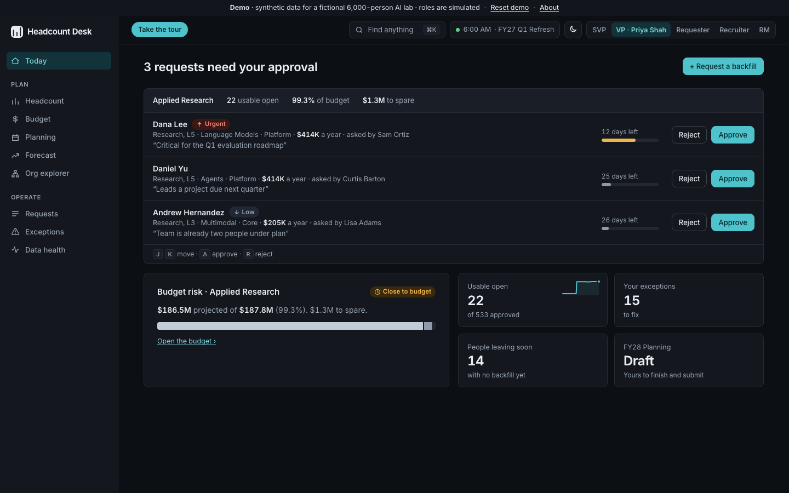
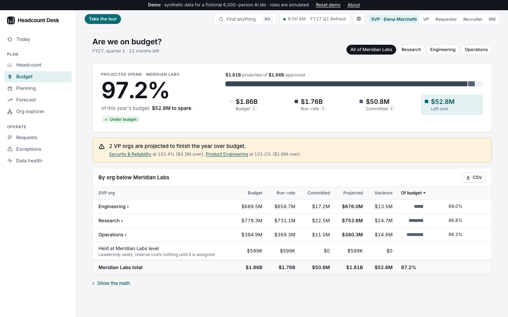
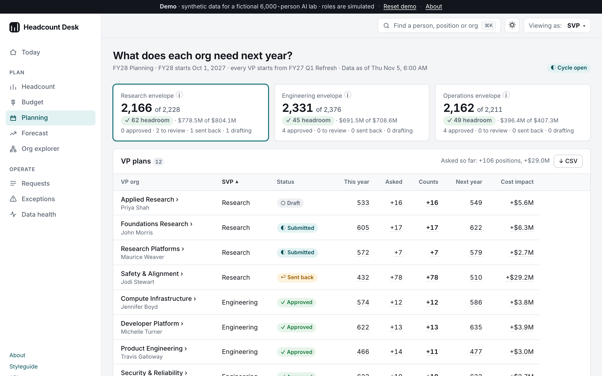
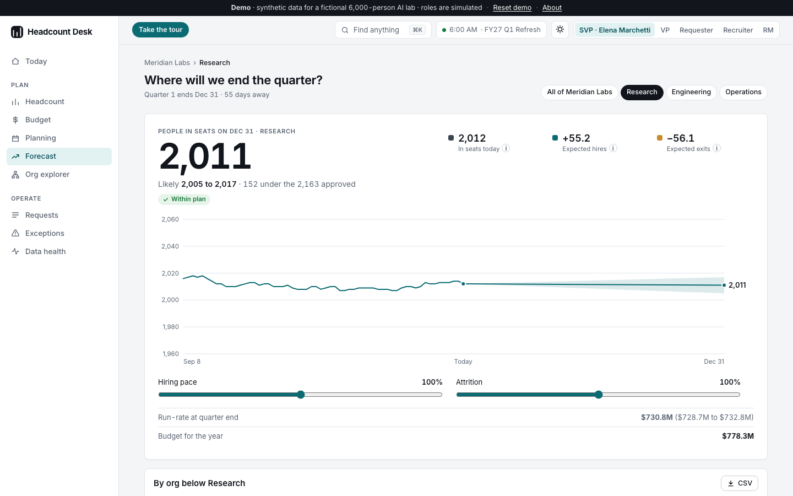
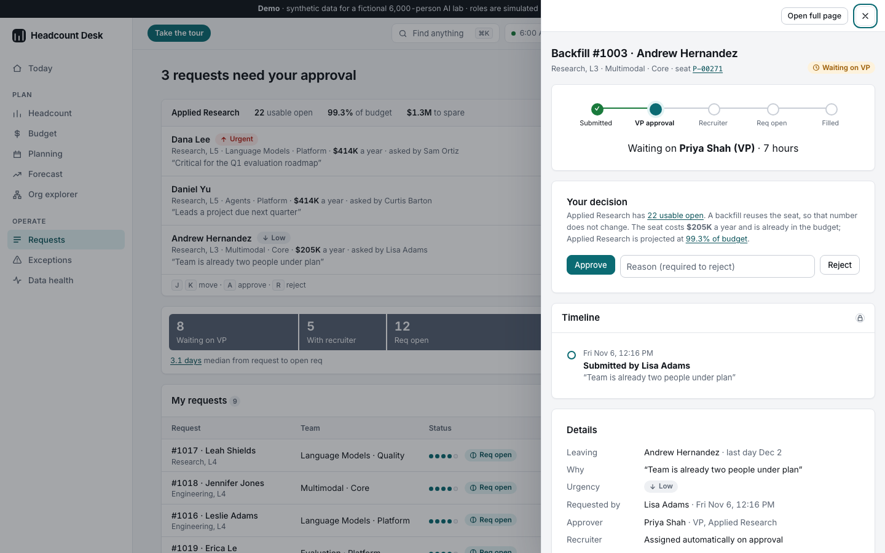

# Headcount Desk

**How many people can we actually hire, and are we on budget?** Headcount Desk is a working resource-management product for a fictional 6,000-person AI research lab. It covers people and dollars: usable open headcount, budget, next year's plan, a quarter-end forecast, a tracked backfill flow, and data checks that say whether the numbers can be trusted.

**Live demo:** https://headcount-desk-yf5labkepq-ue.a.run.app

All data is synthetic. The company ("Meridian Labs"), the people, the cost rates and the numbers are made up, and errors are planted on purpose so there is something to find.


## What it does

| Page | The question it answers | What you see |
|---|---|---|
| **Today** | What needs me? | A home page per role: what changed since yesterday (SVP), approvals and budget risk (VP), aging roles (recruiter), exceptions and failing checks (resource manager). |
| **Headcount** | How many people can we actually hire? | Usable open for any org, a seat map of every unfilled seat, and the same numbers for each org below. |
| **Budget** | Are we on budget? | Projected spend against the plan: run-rate plus committed seats for the months left. Over, close or under, for every org. |
| **Planning** | What does each org need next year? | The FY28 cycle: VPs propose adds and cuts with a live dollar impact, the SVP reviews against an envelope, and locking writes a new plan version. |
| **Forecast** | Where will we end the quarter? | Projected people in seats drawn from real history into a likely range, with what-if sliders and the method one click away. |
| **Org explorer** | Who sits where, and what does it cost? | The hierarchy from company to team, as a table or a zoomable map, with seats and dollars at each level. |
| **Requests** | Where is my backfill? | A two-question form, a one-click approval inbox with the cost shown, an auto-assigned recruiter, and a full audit trail. |
| **Exceptions** | What's wrong in the data, and who fixes it? | Stale opens, duplicates, ghost fills, mis-coded seats and misplaced reserve, as a to-do list by owner, with bulk resolve and undo. |
| **Data health** | Can I trust these numbers? | Eight daily checks by day in one grid, in plain sentences, with links to the rows. |

Every number opens the rows behind it. Detail opens in a side drawer, so you never lose your place. Press **⌘K** (or `/`) to jump to any person, position or org.

Try it in two minutes:

1. Open **Headcount** and click a segment of the bar to see the positions behind it.
2. **Request a backfill** as a Requester, switch to **VP** (top right) and approve it from the Today page. The card shows what the seat costs.
3. Open **Planning** as the VP, change your ask and submit it. Switch to **SVP**, approve it, and lock the plan.
4. Open **Data health** and find the overnight anomaly.

| Today (VP), dark | Budget | Planning |
|---|---|---|
|  |  |  |

| Forecast | Detail drawer | On a phone |
|---|---|---|
|  |  |  |

## How it works

```
usable open     = approved (current locked plan) − filled − committed − reserve − negative

projected spend = run-rate (annual cost of every seat with a person in it)
                + committed seats × the share of the fiscal year that is left

quarter-end     = people in seats today
                + open requests, each weighted by its chance of being filled in time
                − people in seats × observed monthly attrition × months left
```

- **The logic is SQL.** Usable open, the budget, the exception rules, the forecast and the data checks are Postgres views in [`db/views/`](db/views). Python routes requests and renders pages, so anyone who reads SQL can check a rule.
- **A position's status is derived, never stored.** `v_position_status` works out whether a seat is filled, committed or open from the facts, so it cannot drift.
- **Plans are versioned and locked.** A trigger blocks edits to a locked plan, a stored fingerprint lets a daily check prove nobody got around the trigger, and locking next year's plan does not change this year's numbers.
- **One function owns each workflow.** `transition()` in [`app/workflow.py`](app/workflow.py) (backfills) and [`app/planning.py`](app/planning.py) (annual planning) is the only code that changes a status, and it writes the audit row in the same transaction.
- **Rules are enforced on the server.** Roles are simulated with a switcher, but who may approve, recruit, resolve or lock is checked in [`app/permissions.py`](app/permissions.py) on every write and covered by tests.

More in [docs/PRD.md](docs/PRD.md) (problem, users, roadmap), [docs/SCHEMA.md](docs/SCHEMA.md) (tables, views, ER diagram), [docs/DESIGN.md](docs/DESIGN.md) (the design system) and [docs/DECISIONS.md](docs/DECISIONS.md) (each choice and the alternative). [docs/WALKTHROUGH.md](docs/WALKTHROUGH.md) is a guided read of the code.

## Stack

| Layer | Choice |
|---|---|
| Language | Python 3.12, managed with `uv` |
| Web | FastAPI, Jinja2 templates, HTMX for in-place updates |
| Interface | One hand-written stylesheet built on design tokens, light and dark; no CSS or chart framework; no CDNs |
| Database | Postgres (Neon), `psycopg` 3, plain SQL, numbered migrations |
| Safety | CSRF tokens, a strict Content Security Policy, rate limits, server-side role permissions, JSON request logs |
| Tests | `pytest` unit tests plus Playwright end-to-end tests with axe-core, in GitHub Actions on every PR |
| Hosting | Cloud Run |

There is also a small read-only JSON API over the same views, documented at [`/docs`](https://headcount-desk-yf5labkepq-ue.a.run.app/docs), and every component is shown in both themes at [`/styleguide`](https://headcount-desk-yf5labkepq-ue.a.run.app/styleguide).

## Run it locally

You need [`uv`](https://docs.astral.sh/uv/) and a Postgres database (a free [Neon](https://neon.tech) project works).

```bash
cp .env.example .env                    # then put your connection string in DATABASE_URL
uv sync
uv run python -m scripts.migrate        # apply migrations and build the views
uv run python -m scripts.seed           # load about 6,000 synthetic people
uv run uvicorn app.main:app --reload    # http://127.0.0.1:8000
```

Other commands:

```bash
uv run playwright install chromium      # once, for the browser tests
uv run pytest -q                        # unit and end-to-end tests, in their own schema
uv run python -m scripts.run_checks     # run the data checks from the command line
./scripts/deploy.sh                     # deploy to Cloud Run
```

## Layout

```
app/
  main.py            the FastAPI app, role switcher, command palette, error pages
  security.py        CSRF, security headers, rate limit, request logs
  permissions.py     who may do what
  workflow.py        the backfill state machine
  planning.py        the annual planning cycle
  checks.py          runs the SQL checks and stores the results
  web.py  db.py      templates, formatting, sorting and CSV; connection pool
  routes/            one file per area, plus the JSON API
  templates/ static/
db/
  migrations/        numbered; each runs once and is recorded in schema_migrations
  views/             the business rules; rebuilt on every migrate
scripts/             migrate, seed, run_checks, deploy
tests/               hand-worked fixtures, planted errors, workflows, permissions, browser tests
docs/                PRD, schema, design system, decisions, walkthrough
seed_manifest.json   every error the seed plants (the tests assert each is caught)
```

## About the data

`scripts/seed.py` builds the same company every time from a fixed random seed. It plants 150 stale opens, 20 duplicate seats, 15 ghost fills, 30 mis-coded seats, 25 misplaced reserve seats, 12 over-hires and one overnight anomaly, and records them in `seed_manifest.json`. It puts two VP orgs over budget and leaves the FY28 planning cycle half finished, so there is something to decide. Dates are relative to today and the data rebuilds itself once a day, so the demo always looks like it loaded this morning. "Reset demo" in the top banner rebuilds it on demand.

---

Built by Avi Sheth · [LinkedIn](https://www.linkedin.com/in/avisheth1)
