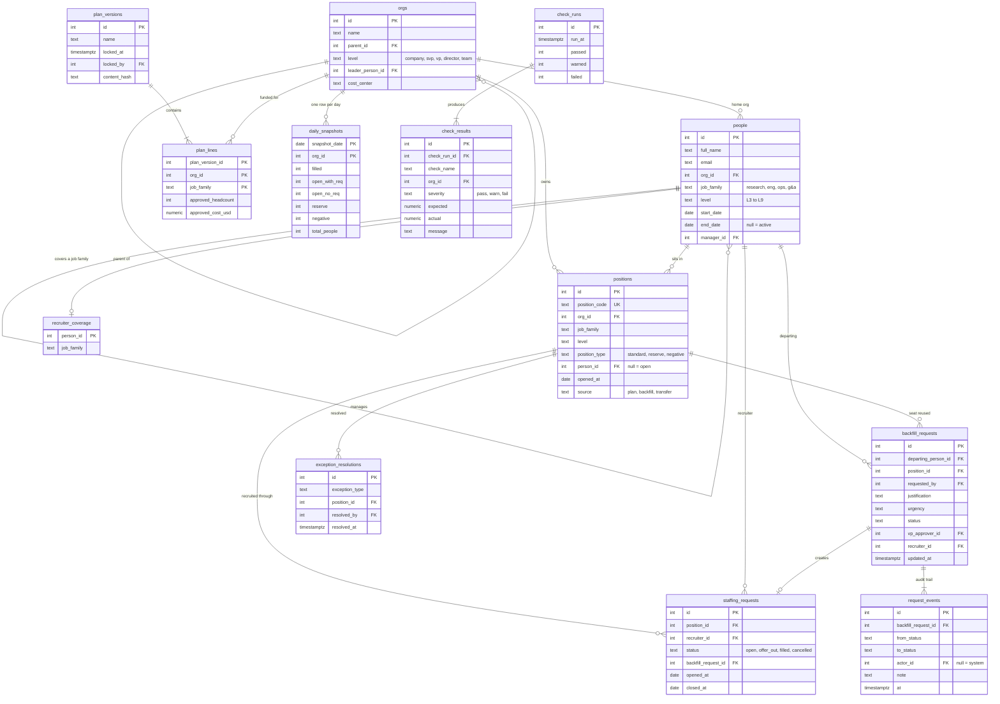

# Schema

Plain Postgres. Tables are in [`db/schema.sql`](../db/schema.sql); the business logic lives in views in [`db/views.sql`](../db/views.sql) and [`db/checks.sql`](../db/checks.sql).

## Diagram

## The tables in plain English

| Table | One row is | Notes |
|---|---|---|
| `orgs` | A box on the org chart | A tree: company → SVP → VP → director → team. `parent_id` points up. |
| `people` | A person, past or present | `end_date` null means active. A future `end_date` means they have given notice. |
| `positions` | A seat | Filled when `person_id` is set. `reserve` seats are held back by an SVP; `negative` seats are over-hires with no approved headcount behind them. |
| `staffing_requests` | A recruiter working to fill a seat | At most one active request per seat (a partial unique index enforces it). |
| `plan_versions` / `plan_lines` | A locked headcount plan and its lines | Approved headcount and cost by org and job family. |
| `backfill_requests` | A manager asking to replace someone | Moves through a fixed set of statuses. |
| `request_events` | One status change on a backfill | Append-only audit trail. |
| `daily_snapshots` | Yesterday's (and every day's) totals for one org | Rolled-up totals, stored so today can be compared to yesterday. |
| `check_runs` / `check_results` | A run of the data checks and what each found | One result row per org tested. |
| `exception_resolutions` | Someone marking a data problem as dealt with | Keeps the to-do list honest without hiding the underlying row. |
| `recruiter_coverage` | Which job family a recruiter hires for | Used for auto-assignment. |

## The views

| View | What it answers |
|---|---|
| `v_org_closure` | Every org paired with each of its ancestors (and itself). This is what makes roll-ups one join. |
| `v_org_path` | For each org: its SVP, VP and director. |
| `v_position_status` | Each seat's bucket: filled, committed, open with no request, reserve or negative. **Derived, never stored.** |
| `v_headcount_direct` | Approved headcount and seats by bucket for the seats that sit directly in each org. |
| `v_usable_open` | The same, rolled up the tree, plus `usable_open`. |
| `v_exceptions` | A union of five data-quality rules, with an owner and a suggested fix. |
| `v_check_*` | One view per data check, all with the same columns, unioned in `v_check_all`. |

## Four design decisions

1. **"Open" is derived, not stored.** A seat is *filled* if `person_id` is set, *committed* if it has an active staffing request, and otherwise *open with no request*. A status you derive cannot drift out of sync with the facts it is derived from.
2. **Plans are versioned and locked.** `plan_lines` are never edited in place; a refresh is a new `plan_version`. A trigger blocks changes to a locked plan, and `content_hash` lets a daily check prove nobody got around the trigger.
3. **Workflow state changes through one function.** `app/workflow.py: transition()` is the only code that changes a backfill's status. It checks the move is legal and writes a `request_events` row in the same transaction, so every change has an actor and a timestamp and you cannot skip a step.
4. **Snapshots exist for tie-outs.** You cannot compare today to yesterday unless yesterday's numbers were stored. `daily_snapshots` keeps one row per org per day.

More choices, with the alternatives considered, are in [DECISIONS.md](DECISIONS.md).
