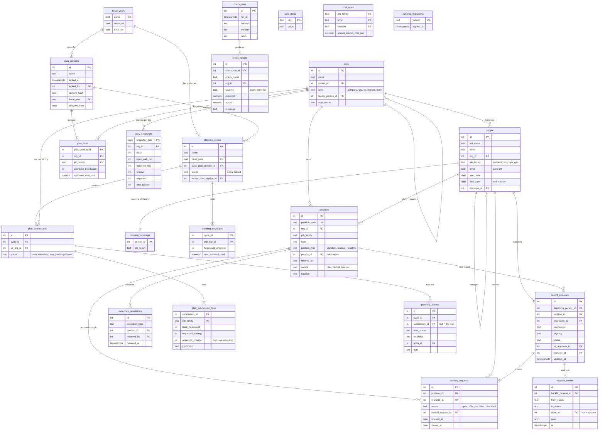

# Schema

Plain Postgres. Tables are created by numbered migrations in [`db/migrations/`](../db/migrations); the business logic lives in views in [`db/views/`](../db/views).

## Diagram

## The tables in plain English

| Table | One row is | Notes |
|---|---|---|
| `orgs` | A box on the org chart | A tree: company → SVP → VP → director → team. `parent_id` points up. |
| `people` | A person, past or present | `end_date` null means active. A future `end_date` means they have given notice. |
| `positions` | A seat | Filled when `person_id` is set. `reserve` seats are held back by an SVP; `negative` seats are over-hires with no approved headcount behind them. |
| `staffing_requests` | A recruiter working to fill a seat | At most one active request per seat (a partial unique index enforces it). |
| `plan_versions` / `plan_lines` | A locked headcount plan and its lines | Approved headcount and cost by org and job family. |
| `backfill_requests` | A manager asking to replace someone | Moves through a fixed set of statuses. |
| `request_events` | One status change on a backfill | Append-only audit trail. |
| `daily_snapshots` | Yesterday's (and every day's) totals for one org | Rolled-up totals, stored so today can be compared to yesterday. |
| `check_runs` / `check_results` | A run of the data checks and what each found | One result row per org tested. |
| `exception_resolutions` | Someone marking a data problem as dealt with | Keeps the to-do list honest without hiding the underlying row. |
| `recruiter_coverage` | Which job family a recruiter hires for | Used for auto-assignment. |
| `app_meta` | A key and a value | Demo bookkeeping: the date the data was built for, and which person each demo role maps to. |
| `cost_rates` | The annual loaded cost of one seat | By job family, level and location. Synthetic numbers. |
| `fiscal_years` | A fiscal year and its dates | "Months left" and "quarter end" come from here. |
| `planning_cycles` | One annual planning round | Points at the plan every VP starts from, and at the plan it produced once locked. |
| `planning_envelopes` | The top-down limit for one SVP | Headcount and dollars. |
| `plan_submissions` / `plan_submission_lines` | One VP's ask, and its lines by job family | A line holds this year's number, the change requested, the change approved and the reason. |
| `planning_events` | One status change in the planning cycle | Append-only, like `request_events`. |
| `schema_migrations` | A migration that has been applied | How the database knows which numbered files it has already run. |

## The views

| View | What it answers |
|---|---|
| `v_org_closure` | Every org paired with each of its ancestors (and itself). This is what makes a roll-up one join. |
| `v_org_path` | For each org: its SVP, VP and director. |
| `v_position_status` | Each seat's bucket: filled, committed, open with no request, reserve or negative. **Derived, never stored.** |
| `v_current_plan` | The most recently locked plan version. |
| `v_headcount_direct` | Approved headcount and seats by bucket for the seats that sit directly in each org. |
| `v_usable_open` | The same, rolled up the tree, plus `usable_open`. |
| `v_exception_rules` | A union of five data-quality rules, one SELECT per rule. |
| `v_exceptions` | The rules plus an owner (the VP over the seat), an age, a suggested fix and whether it has been resolved. |
| `v_recruiter_load` | How many roles each recruiter is carrying. Auto-assignment picks the lowest. |
| `v_backfill_candidates` | Who can be backfilled: someone with an end date who still holds a seat and has no live request. |
| `v_backfill_requests` | Each request with names, who it is waiting on, and time in its current status. |
| `v_backfill_cycle_time` | Days from submitted to an open staffing request, read from the audit trail. |
| `v_snapshot_days` | The two most recent snapshot dates ("today" and "yesterday"). |
| `v_check_tieout`, `v_check_rollup`, `v_check_referential`, `v_check_ratio`, `v_check_plan_integrity`, `v_check_open_share` | One view per data check, all with the same six columns. |
| `v_check_budget`, `v_check_cost_rates` | Two more checks added with the cost model. |
| `v_check_all` | Every check unioned. Running the checks is one `INSERT ... SELECT` from this. |
| `v_fiscal_now` | Where we are in the fiscal year: months left, the quarter, when it ends. |
| `v_position_cost` | Each seat with its annual cost from the rate card. |
| `v_budget_direct`, `v_budget` | Budget, run-rate, committed and projected spend: first for the seats directly in each org, then rolled up, with an over / watch / under state. |
| `v_plan_submission_lines`, `v_plan_submissions` | Planning asks with the change that counts and its cost, by line and by VP. |
| `v_planning_envelopes` | Each SVP's envelope against what their VPs have asked for. |
| `v_time_to_fill`, `v_fill_probability` | How long past requests took, and each open request's chance of being filled by quarter end. |
| `v_attrition` | Observed monthly attrition over the last 60 days, by SVP org. |
| `v_forecast` | Projected people in seats and run-rate at quarter end, with a P25 to P75 range. |

Two small things worth knowing:

- `positions.opened_at` means "when the seat was created or last vacated", so a seat's age as an open seat restarts when someone leaves it.
- `today()` is a SQL function that returns the business date in US Eastern time. Every rule that depends on the date uses it.
- `v_current_plan` is the latest locked plan that is already in effect (`effective_from` on or before today). Next year's plan can be locked without touching this year's numbers.

## Four design decisions

1. **"Open" is derived, not stored.** A seat is *filled* if `person_id` is set, *committed* if it has an active staffing request, and otherwise *open with no request*. A status you derive cannot drift out of sync with the facts it is derived from.
2. **Plans are versioned and locked.** `plan_lines` are never edited in place; a refresh is a new `plan_version`. A trigger blocks changes to a locked plan, and `content_hash` lets a daily check prove nobody got around the trigger.
3. **Workflow state changes through one function.** `app/workflow.py: transition()` is the only code that changes a backfill's status. It checks the move is legal and writes a `request_events` row in the same transaction, so every change has an actor and a timestamp and you cannot skip a step.
4. **Snapshots exist for tie-outs.** You cannot compare today to yesterday unless yesterday's numbers were stored. `daily_snapshots` keeps one row per org per day.

More choices, with the alternatives considered, are in [DECISIONS.md](DECISIONS.md).
